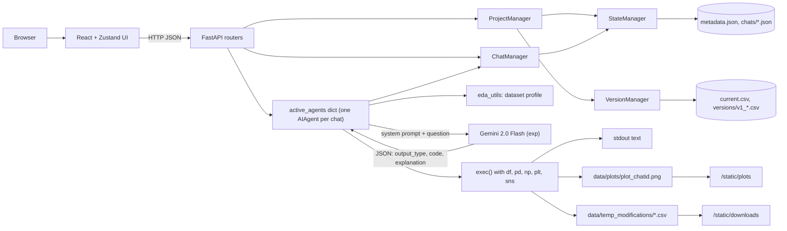

# AI Data Analyst v2

A local full-stack app for asking questions about CSV files in plain English. Upload a dataset, look at its automatic profile, keep several chats per dataset, and have Google Gemini write pandas code that the backend runs against the full DataFrame. Answers come back as printed text, a matplotlib chart, or a downloadable CSV.

React/TypeScript frontend, FastAPI backend. Projects, chats, dataset snapshots, plots and generated CSVs live on the local filesystem. There is no database.

> **Security boundary:** Gemini-generated Python runs with `exec()` inside the backend process, with pandas, NumPy, matplotlib, seaborn and the normal Python built-ins available. It is not a sandbox. Only run this for trusted users and data, on a machine or container where generated code cannot reach anything sensitive.

## Background

v1 was a single-file Streamlit app: one CSV, one chat, nothing kept after a refresh (see `backend/IMPLEMENTATION_PLAN_V2.md`). v2 splits the logic into managers with file-based persistence, so each dataset becomes a project with its own profile and conversations that survive a restart. A later Streamlit UI built on the v2 managers is still in `backend/chat_analyst_ui.py`; the React app in `frontend/` is the main UI.

## How it got here

Full reasoned history in `docs/NOTES.md` ("Evolution").

1. **Mar 2025, dashboard platform** ([Project3](https://github.com/tarangdeep-goel-by/Project3), [882e5b7](https://github.com/tarangdeep-goel-by/Project3/commit/882e5b7)): React + FastAPI aggregation, formula metrics and WebSocket backends. No LLM.
2. **Mar-Apr 2025, CSV visualiser** ([csv-data-visualizer](https://github.com/tarangdeep-goel-by/csv-data-visualizer), [35a56ac](https://github.com/tarangdeep-goel-by/csv-data-visualizer/commit/35a56ac) to [55f0118](https://github.com/tarangdeep-goel-by/csv-data-visualizer/commit/55f0118)): dimension/metric classification, filters, aggregation, Recharts charts, value comparison, filtered download.
3. **May 2025, files and saved views** ([fa88f39](https://github.com/tarangdeep-goel-by/csv-data-visualizer/commit/fa88f39), [d54fb09](https://github.com/tarangdeep-goel-by/csv-data-visualizer/commit/d54fb09), [9f901a3](https://github.com/tarangdeep-goel-by/csv-data-visualizer/commit/9f901a3)): several files, each with saved filter views and data snapshots; Docker.
4. **By 6 Jan 2026, v1 Streamlit chat** (app not in git; see `backend/IMPLEMENTATION_PLAN_V2.md`, and its `auto_eda.py` committed in c010103): Gemini writes pandas for one CSV, run on the full DataFrame. One file, one chat, lost on refresh.
5. **8 Jan 2026, v2 rebuild** ([c010103](https://github.com/tarangdeep-goel-by/ai-data-analyst-v2/commit/c010103)): managers with file persistence, projects with many chats, FastAPI, React UI; Streamlit UI kept on the same managers.
6. **10-17 Jan 2026, Docker and prompt fixes** ([7d61566](https://github.com/tarangdeep-goel-by/ai-data-analyst-v2/commit/7d61566), [fd359ff](https://github.com/tarangdeep-goel-by/ai-data-analyst-v2/commit/fd359ff)); public-release cleanup in Apr 2026 ([bb485ad](https://github.com/tarangdeep-goel-by/ai-data-analyst-v2/commit/bb485ad)).

No stage uses tool or function calling: today it is one Gemini call per question returning JSON + code, run with `exec()`.

## Features

- CSV upload and project management (list, open, delete)
- Dataset profile modal: shape, dtypes, null percentages, numeric/categorical column counts and the first 10 rows. The text profile sent to the model also has numeric ranges, low-cardinality value counts and a warning for columns that hold stringified lists/sets/dicts
- Multiple persistent chats per project
- Three answer types chosen by the model per question:
  - `exploratory`: printed text output
  - `visualization`: a matplotlib/seaborn PNG
  - `modification`: a transformed DataFrame offered as a CSV download, with before/after row and column counts and a 10-row preview
- Generated code shown with each answer (collapsible, copyable)
- Initial dataset snapshot on upload, plus a file-based version manager (new version, revert, cleanup) that is not yet wired to the API or UI
- Atomic JSON writes (temp file, then rename)
- OpenAPI docs from FastAPI
- Docker Compose setup

## How it works



### Request flow

1. `POST /api/projects/upload` parses the CSV with pandas, creates `metadata.json`, writes `current.csv` and `versions/v1_<timestamp>.csv`, and creates a default chat named "Chat 1".
2. `GET /api/projects/{project_id}/context` profiles `current.csv` for the data-context modal.
3. `POST /api/ai/{project_id}/{chat_id}/query` looks up an `AIAgent` for that chat in a process-wide dict. If there is none, it loads `current.csv`, builds the text profile (`backend/src/eda_utils.py`), starts a new Gemini chat, and sends the system prompt as the first message.
4. The question is sent to that Gemini chat. The reply must be JSON with `output_type`, `code` and `explanation`; a surrounding Markdown code fence is stripped before parsing.
5. The backend runs the code with `exec()` and captures:
   - `exploratory`: stdout
   - `visualization`: the code must save `plot.png` in the working directory; it is moved to `data/plots/plot_<chat_id>.png`
   - `modification`: the code must assign a DataFrame to `result`; it is written to `data/temp_modifications/<chat_id>_<hex>.csv`
6. The user message is written to the chat JSON before the model call. On success, the assistant message (with code, output, file paths and summary) and the serialised Gemini history are written too, and the frontend reloads the chat's messages. The model never sees the printed output or chart, only its own JSON replies.

One model call per question. If the generated code fails, the error is returned; there is no automatic retry.

Modifications are downloads only. They do not update `current.csv` or create a new version.

## Repository layout

```text
.
├── backend/
│   ├── api/
│   │   ├── main.py              # FastAPI app, CORS, static mounts
│   │   ├── schemas.py           # Pydantic request/response models
│   │   └── routers/             # projects.py, chats.py, ai_query.py
│   ├── src/
│   │   ├── ai_agent.py          # Gemini session, system prompt, JSON parsing, exec()
│   │   ├── eda_utils.py         # Dataset profile sent to the model
│   │   ├── project_manager.py   # Project orchestration
│   │   ├── chat_manager.py      # Chats, messages, stored Gemini history
│   │   ├── version_manager.py   # CSV snapshots, revert, cleanup
│   │   ├── state_manager.py     # File layout and JSON persistence
│   │   ├── models.py            # Project, Chat, Message, Version dataclasses
│   │   └── utils.py             # Atomic JSON writes, path helpers
│   ├── chat_analyst_ui.py       # Older Streamlit UI on the same backend modules
│   ├── auto_eda.py              # v1-era standalone EDA script (not used by the API)
│   ├── test_phase1.py           # Manager/persistence tests (no Gemini)
│   ├── test_phase2.py           # Live Gemini tests
│   ├── demo_backend.py
│   ├── run_api.py
│   ├── requirements.txt
│   └── Dockerfile
├── frontend/
│   ├── src/
│   │   ├── components/          # layout, project, chat, modals, shadcn/ui primitives
│   │   ├── services/            # Typed HTTP clients
│   │   ├── store/appStore.ts    # Zustand store
│   │   ├── types/               # API-to-UI converters
│   │   └── config/api.ts        # API base URL and endpoint map
│   ├── package.json
│   ├── vite.config.ts
│   ├── nginx.conf
│   └── Dockerfile
├── docs/NOTES.md                # Detailed research notes on the code
└── docker-compose.yml
```

## Requirements

- Python 3.9+
- Node.js 18+ and npm
- A Google Gemini API key

Or Docker with Compose.

## Configuration

`backend/.env` (`backend/.env.example` has only the key):

```dotenv
GEMINI_API_KEY=your-google-gemini-api-key
# Optional, default shown
DATA_DIR=data
```

The backend reads only `GEMINI_API_KEY` and `DATA_DIR`. `run_api.py` always binds `0.0.0.0:8000`; the `API_HOST` and `API_PORT` values in Compose are not read. `api/main.py` mounts the static directories at the hard-coded paths `data/plots` and `data/temp_modifications`, so keep `DATA_DIR` as `data` (or `/app/data` in the container, where the working directory is `/app`).

`frontend/.env` (optional):

```dotenv
VITE_API_BASE_URL=http://localhost:8000
```

Most API calls fall back to `http://localhost:8000` if this is unset, but the CSV download button does not, so set it for local development.

## Run locally

Backend:

```bash
cd backend
python3 -m venv .venv
source .venv/bin/activate
pip install -r requirements.txt
python3 run_api.py
```

API at `http://localhost:8000`, Swagger UI at `http://localhost:8000/api/docs`.

Frontend, in another terminal:

```bash
cd frontend
npm install
npm run dev
```

Vite serves on `http://localhost:8080` (`frontend/vite.config.ts`).

The older Streamlit UI runs on the same data directory:

```bash
cd backend
streamlit run chat_analyst_ui.py
```

## Run with Docker Compose

```bash
export GEMINI_API_KEY=your-google-gemini-api-key   # Compose interpolates it
docker compose up --build
```

`backend/.env` is also mounted read-only into the backend container, so create it first. It does not supply the key: Compose always sets `GEMINI_API_KEY` (empty if you did not export it) and python-dotenv does not override existing variables.

The `VITE_API_BASE_URL` set in Compose is a runtime variable and has no effect on the already-built frontend. The build uses `frontend/.env` if it exists (it is not in `.dockerignore`); without it the CSV download button breaks as described below.

| Service | URL | Data |
| --- | --- | --- |
| Frontend (nginx) | `http://localhost` | static build |
| Backend | `http://localhost:8000` | named volume at `/app/data` |
| API docs | `http://localhost:8000/api/docs` | |

Stop with `docker compose down`. `start-backend.sh`, `start-frontend.sh` and `stop-all.sh` run `docker-compose up -d backend`, `docker-compose up -d frontend` and `docker-compose stop` (the older hyphenated CLI).

Note: the frontend container is served from `http://localhost` (port 80), which is not in the backend's CORS allow list (`api/main.py` allows ports 5173, 3000 and 8080). Add `http://localhost` there if browser requests from the Docker frontend are blocked.

## API

### Projects

| Method | Path | Purpose |
| --- | --- | --- |
| `GET` | `/api/projects/` | List projects |
| `POST` | `/api/projects/upload` | Multipart `file` + `project_name`; create a project |
| `GET` | `/api/projects/{project_id}` | Project metadata |
| `GET` | `/api/projects/{project_id}/context` | Structured dataset profile |
| `DELETE` | `/api/projects/{project_id}` | Delete a project and its files |

### Chats

| Method | Path | Purpose |
| --- | --- | --- |
| `GET` / `POST` | `/api/chats/{project_id}` | List or create chats |
| `GET` / `PATCH` / `DELETE` | `/api/chats/{project_id}/{chat_id}` | Read, rename or delete a chat |
| `GET` / `DELETE` | `/api/chats/{project_id}/{chat_id}/messages` | Read or clear messages |

### AI

| Method | Path | Purpose |
| --- | --- | --- |
| `POST` | `/api/ai/{project_id}/{chat_id}/query` | Body `{"query": "..."}`; generate and run code |
| `DELETE` | `/api/ai/{project_id}/{chat_id}/session` | Drop the in-memory Gemini session |
| `GET` | `/api/ai/health` | Gemini key configured, active session count |

Generated files are served from `/static/plots/` and `/static/downloads/`. There is also `GET /health` (used by the Docker health check) and `GET /`.

## Data on disk

```text
data/
├── projects/
│   └── <project-id>/
│       ├── metadata.json
│       ├── current.csv
│       ├── versions/
│       │   ├── version_log.json
│       │   └── v1_<timestamp>.csv
│       └── chats/
│           └── <chat-id>.json
├── plots/                       # plot_<chat-id>.png
└── temp_modifications/          # <chat-id>_<hex>.csv
```

Deleting a project removes its directory. Plots and downloads are never cleaned up.

## Tests

Script-style, no pytest config:

```bash
cd backend
python3 test_phase1.py   # managers and persistence, no Gemini
python3 test_phase2.py   # live Gemini calls, needs GEMINI_API_KEY exported (it does not read .env)
```

Frontend: `npm run lint` and `npm run build`. There is no `npm test`.

## Known limitations and bugs

- No authentication. CORS is not access control.
- Generated code is not sandboxed.
- Gemini sessions live in process memory. History is saved to each chat file but never loaded back, so after a backend restart the model has no memory of earlier turns even though the UI shows them.
- One chart file per chat (`plot_<chat_id>.png`): each new chart in a chat overwrites the previous one, so older chart messages show the latest image.
- The chart `` in `ChatMessage.tsx` uses the relative `/static/plots/...` URL, which resolves against the frontend's origin rather than the backend's. Charts may not display in the React UI until that URL is prefixed with `API_BASE_URL`.
- No retry when generated code fails. A failed query still saves the user's message.
- Generated code gets the agent's live DataFrame as `df`, so code that changes `df` in place changes the data for later questions in that session (not `current.csv`).
- Clearing a chat's messages, or deleting a chat or project, does not drop its in-memory Gemini session.
- Route handlers are `async` but call the blocking Gemini SDK and `exec()`, so the server processes one query at a time.
- The frontend aborts requests after 30 s.
- Model `gemini-2.0-flash-exp` via the deprecated `google-generativeai` package; the model name may no longer be available.
- CSV only, read fully into memory, no size limit.
- Modifications never become a new project version; version history and revert exist only in `VersionManager`.
- `CLAUDE.md` and the older guides (`START_GUIDE.md`, `DOCKER_GUIDE.md`, `backend/*.md`) predate parts of the code and are not fully accurate. `docs/NOTES.md` is the up-to-date reference.
