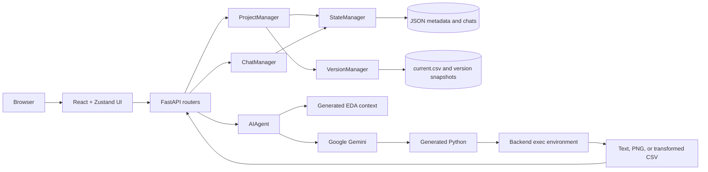

# AI Data Analyst

A local full-stack application for conversational analysis of CSV files. Upload a dataset, inspect its automatically generated profile, organize analysis into chats, and ask Gemini to generate pandas code for calculations, visualizations, or downloadable transformations.

The project pairs a React/TypeScript interface with a FastAPI backend. Project metadata, chat history, dataset snapshots, plots, and generated CSVs are stored on the local filesystem; no database server is required.

> **Security boundary:** Gemini-generated Python is executed with `exec()` in the backend process. The current execution environment exposes pandas, NumPy, matplotlib, seaborn, and normal Python built-ins; it is not an OS-level sandbox. Run this application only for trusted users and data, on a machine or container where generated code cannot reach sensitive resources.

## Why this exists

A lot of useful data arrives as a CSV, but answering even a simple follow-up question often means opening a notebook, remembering pandas syntax, cleaning the file, and rebuilding the context the next time you return. The person with the question and the person who can write the analysis are often not the same person.

The first version of this project proved that a user could ask questions in plain language and have an AI work against the full DataFrame. It also exposed the limits of a one-file, one-session demo: refresh the app and the working context disappeared; upload another dataset and the previous conversation was in the way.

Version 2 turns that experiment into a small analysis workspace. Each dataset becomes a project with its own profile and conversations, results can be charts or downloadable transformations, and the work survives a restart. The goal is not to replace a data scientist. It is to shorten the distance between “I have this file” and “I understand what it says,” while still showing the generated code and preserving the underlying data.

## Features

- CSV upload and project management
- Automatic dataset context: shape, types, null counts, numeric ranges, samples, and low-cardinality distributions
- Multiple persistent chat threads per project
- Natural-language exploratory analysis with captured textual output
- Generated matplotlib/seaborn visualizations served back to the UI
- Downloadable CSV transformations with before/after summaries and previews
- Initial dataset snapshot plus reusable file-based version-management primitives
- Local JSON and CSV persistence with atomic JSON writes
- Interactive OpenAPI documentation from FastAPI
- Docker Compose and separate local-development workflows

## How it works



### Request flow

1. `POST /api/projects/upload` parses a CSV with pandas, creates project metadata, writes `current.csv` and the initial version snapshot, generates a default chat, and stores everything below `DATA_DIR`.
2. `GET /api/projects/{project_id}/context` profiles the current DataFrame for the data-context view.
3. `POST /api/ai/{project_id}/{chat_id}/query` starts or reuses an in-memory Gemini session seeded with the dataset profile.
4. Gemini returns JSON containing an output type, Python code, and an explanation.
5. The backend executes the code against the current DataFrame and captures one of three outputs:
   - `exploratory`: printed text
   - `visualization`: a generated `plot.png`, moved into the plots directory
   - `modification`: a DataFrame assigned to `result`, exported as a temporary downloadable CSV
6. Successful user and assistant messages, generated code, output paths, and Gemini history are written to the chat file.

Generated modifications are downloads; the current API does not promote them into a new active project version. The version manager supports additional snapshots and reverts internally, but those operations are not exposed in the current web UI or routers.

## Repository layout

```text
.
├── backend/
│   ├── api/
│   │   ├── main.py              # FastAPI app, CORS, static mounts
│   │   ├── schemas.py           # Request and response models
│   │   └── routers/             # Projects, chats, and AI query endpoints
│   ├── src/
│   │   ├── ai_agent.py          # Gemini session, response parsing, code execution
│   │   ├── project_manager.py   # Project orchestration
│   │   ├── chat_manager.py      # Chat and message persistence
│   │   ├── version_manager.py   # CSV snapshots and revert primitives
│   │   ├── state_manager.py     # Atomic JSON persistence
│   │   └── eda_utils.py         # Dataset profiling for model/UI context
│   ├── run_api.py
│   ├── requirements.txt
│   └── Dockerfile
├── frontend/
│   ├── src/
│   │   ├── components/          # App shell, projects, chats, modals, UI primitives
│   │   ├── services/            # Typed HTTP clients
│   │   ├── store/appStore.ts    # Zustand application state
│   │   ├── types/               # API-to-UI type conversion
│   │   └── config/api.ts        # API URL and endpoint map
│   ├── package.json
│   ├── vite.config.ts
│   ├── nginx.conf
│   └── Dockerfile
└── docker-compose.yml
```

## Requirements

For local development:

- Python 3.9 or newer
- Node.js 18 or newer
- npm
- A Google Gemini API key

For the container workflow, Docker with Compose is sufficient.

## Configuration

Create `backend/.env`:

```dotenv
GEMINI_API_KEY=your-google-gemini-api-key

# Optional; defaults shown
API_HOST=0.0.0.0
API_PORT=8000
DATA_DIR=data
```

The backend currently reads `GEMINI_API_KEY` and `DATA_DIR`. `run_api.py` starts Uvicorn on port 8000 directly; `API_HOST` and `API_PORT` are passed by Compose but are not consumed by that launcher.

For local frontend development, optionally create `frontend/.env`:

```dotenv
VITE_API_BASE_URL=http://localhost:8000
```

If unset, the frontend uses `http://localhost:8000`.

## Run locally

Start the backend:

```bash
cd backend
python3 -m venv .venv
source .venv/bin/activate
pip install -r requirements.txt
python3 run_api.py
```

The API is available at `http://localhost:8000`; Swagger UI is at `http://localhost:8000/api/docs`.

In another terminal, start the frontend:

```bash
cd frontend
npm install
npm run dev
```

Vite serves the app at `http://localhost:8080`, as configured in `frontend/vite.config.ts`.

## Run with Docker Compose

Create `backend/.env` first. The Compose file also interpolates `GEMINI_API_KEY` from the shell, so export the same key before starting the stack:

```bash
export GEMINI_API_KEY=your-google-gemini-api-key
docker compose up --build
```

Services:

| Service | URL | Persistent data |
| --- | --- | --- |
| Frontend | `http://localhost` | image is rebuilt from `frontend/` |
| Backend | `http://localhost:8000` | named volume mounted at `/app/data` |
| API docs | `http://localhost:8000/api/docs` | — |

Stop the stack with:

```bash
docker compose down
```

The helper scripts `start-backend.sh`, `start-frontend.sh`, and `stop-all.sh` wrap the same Compose services.

## API overview

### Projects

| Method | Path | Purpose |
| --- | --- | --- |
| `GET` | `/api/projects/` | List projects |
| `POST` | `/api/projects/upload` | Upload a CSV and create a project |
| `GET` | `/api/projects/{project_id}` | Read project metadata |
| `GET` | `/api/projects/{project_id}/context` | Read structured dataset context |
| `DELETE` | `/api/projects/{project_id}` | Delete a project and its stored data |

The upload is multipart form data with fields `file` and `project_name`. The current implementation accepts files by `.csv` extension and parses them with pandas; it does not enforce an upload-size limit.

### Chats

| Method | Path | Purpose |
| --- | --- | --- |
| `GET` / `POST` | `/api/chats/{project_id}` | List or create chats |
| `GET` / `PATCH` / `DELETE` | `/api/chats/{project_id}/{chat_id}` | Read, rename, or delete a chat |
| `GET` / `DELETE` | `/api/chats/{project_id}/{chat_id}/messages` | Read or clear messages |

### AI analysis

| Method | Path | Purpose |
| --- | --- | --- |
| `POST` | `/api/ai/{project_id}/{chat_id}/query` | Generate and execute an analysis |
| `DELETE` | `/api/ai/{project_id}/{chat_id}/session` | Clear the in-memory Gemini session |
| `GET` | `/api/ai/health` | Check Gemini configuration and active sessions |

Generated assets are served from `/static/plots/` and `/static/downloads/`.

## Data on disk

With the default `DATA_DIR=data`, the backend creates a structure equivalent to:

```text
data/
├── config.json
├── projects/
│   └── <project-id>/
│       ├── metadata.json
│       ├── current.csv
│       ├── versions/
│       │   ├── version_log.json
│       │   └── v1_<timestamp>.csv
│       └── chats/
│           └── <chat-id>.json
├── plots/
└── temp_modifications/
```

The Docker named volume preserves this directory across container restarts. Project deletion removes the corresponding project directory. Plot and temporary-download cleanup is not currently automated.

## Validation and tests

Backend tests are executable scripts rather than a configured pytest suite:

```bash
cd backend

# Core managers and file persistence; does not require Gemini
python3 test_phase1.py

# Live Gemini integration; requires GEMINI_API_KEY and makes API calls
python3 test_phase2.py
```

Frontend checks:

```bash
cd frontend
npm run lint
npm run build
```

There is no `npm test` or `npm run type-check` script in the current `package.json`; `npm run build` performs the configured Vite production build.

## Current limitations

- No authentication or authorization is implemented. CORS is limited to configured local origins, but that is not an access-control boundary.
- Generated code execution is not safely sandboxed for untrusted users.
- Gemini conversations are held in process memory while active; restarting the backend recreates sessions from scratch even though serialized history is stored with chats.
- The configured model name is `gemini-2.0-flash-exp`; availability depends on the Google account and SDK version.
- The backend still uses the deprecated `google-generativeai` Python package; migration to `google-genai` is pending.
- Only CSV upload is supported, and there is no enforced file-size limit.
- Downloadable transformations do not update `current.csv` or create a new active version through the API.
- Active AI agents are stored in a process-global dictionary, so multi-worker deployment would not share session state.
- CORS origins are hard-coded for local ports 5173, 3000, and 8080.

Additional operational notes are available in [`START_GUIDE.md`](START_GUIDE.md), [`DOCKER_GUIDE.md`](DOCKER_GUIDE.md), and [`frontend/INTEGRATION_GUIDE.md`](frontend/INTEGRATION_GUIDE.md).
